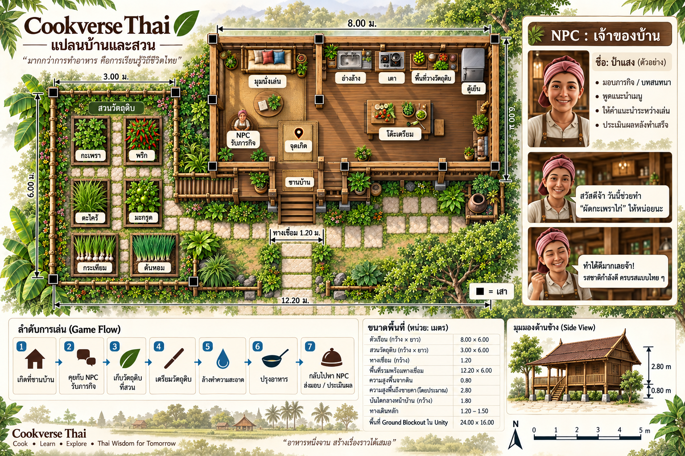
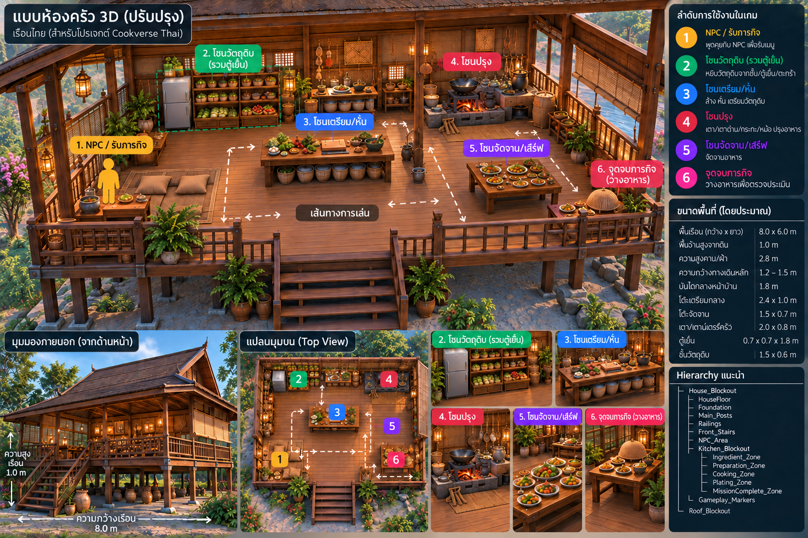

# Cookverse Thai — ผังบ้าน ครัว และสวน

อัปเดต: 22 ตุลาคม 2026  
Scene: `Assets/Scenes/MainVR.unity`  
สถานะ: สร้าง Blockout ใน `MainVR` ครบทุกโซนแล้ว (1 ต.ค.) แต่ **ยังไม่ผ่านการทดสอบบน Quest 3** ขนาดและระยะเอื้อมต้องปรับหลังทดสอบแว่นจริง

เอกสารนี้รวมแผนผังบ้านและสวน (18 ก.ย.) กับแผนครัวฉบับล่าสุด (1 ต.ค.) ไว้ในที่เดียว

## ภาพอ้างอิง

| ภาพ | เนื้อหา |
|---|---|
|  | แปลนบ้านและสวน v5 มองจากด้านบน พร้อมขนาด |
|  | ครัว 3D แบ่ง 6 โซน ขนาดอุปกรณ์ และ Hierarchy |

## ขนาดหลัก

| รายการ | ขนาด (เมตร) |
|---|---|
| ตัวเรือน | 8.0 × 6.0 |
| พื้นบ้านสูงจากดิน | ประมาณ 1.0 (แปลน v5 ระบุ 0.8) |
| ความสูงพื้นถึงชายคา | 2.8 |
| บันไดกลางหน้าบ้าน (กว้าง) | 1.8 |
| ทางเดินหลักในบ้าน | 1.2–1.5 |
| สวนวัตถุดิบ | 3.0 × 6.0 |
| ทางเชื่อมบ้าน–สวน (กว้าง) | 1.2 |
| โต๊ะเตรียมกลาง | 2.4 × 1.0 |
| โต๊ะจัดจาน | 1.5 × 0.7 |
| เตา / เคาน์เตอร์ครัว | 2.0 × 0.8 |
| ตู้เย็น | 0.7 × 0.7 × 1.8 |
| ชั้นวัตถุดิบ | 1.5 × 0.6 |
| พื้น Ground Blockout ใน Unity | 24 × 16 |

> ความสูงพื้นบ้านในภาพสองภาพไม่ตรงกัน (1.0 กับ 0.8) ให้ยึดค่าที่สร้างจริงใน `MainVR` และปรับหลังทดสอบแว่น

## การแบ่งพื้นที่

### ฝั่งซ้าย — ป้าแสงและมุมนั่งเล่น

- `NPC_Area` จุดรับและส่งภารกิจ พร้อมมุมนั่งเล่นเล็ก ๆ
- ผู้เล่นเกิดที่ `PlayerSpawn` บริเวณบนบันได หันหน้าเข้าหาป้าแสง
- ทางเดินจากจุดเกิดไปหาป้าแสงต้องไม่ผ่านโต๊ะหรืออุปกรณ์

### ฝั่งขวา — ครัวรูปตัว L

ลำดับการใช้งานตามเส้นทางเล่น:

| # | โซน | สิ่งที่อยู่ในโซน |
|---|---|---|
| 1 | NPC / รับภารกิจ | ป้าแสง มุมนั่งเล่น |
| 2 | วัตถุดิบ | ตู้เย็น ชั้นวัตถุดิบ ตะกร้ากระเทียม |
| 3 | ล้าง / เตรียม | อ่างล้าง โต๊ะเตรียมกลาง เขียง มีด |
| 4 | ปรุง | เตาแก๊ส ปุ่มบิด กระทะ ตะหลิว |
| 5 | จัดจาน | โต๊ะจัดจาน จาน |
| 6 | จบภารกิจ | จุดวางอาหารเพื่อประเมิน |

### สวนวัตถุดิบข้างบ้าน

| แปลง | บทบาทรอบแรก | หยิบได้ |
|---|---|---|
| กะเพรา | วัตถุดิบหลัก | ✅ เชื่อมภารกิจแล้ว |
| พริก | วัตถุดิบหลัก | ✅ เชื่อมภารกิจแล้ว |
| ตะไคร้ | ฉากประกอบ / เมนูอนาคต | — |
| มะกรูด | ฉากประกอบ / เมนูอนาคต | — |
| กระเทียม, ต้นหอม | ฉากประกอบในแปลน v5 | — |

กระเทียมที่ใช้ในภารกิจหยิบจาก **ตะกร้าในครัว** ไม่ใช่จากแปลงในสวน

## Hierarchy ใน `MainVR`

ชื่อด้านล่างตรงกับวัตถุที่มีอยู่จริงในฉาก (ตรวจ 22 ต.ค.)

```text
Enivronment
├── Ground_Blockout
├── House_Blockout
│   ├── HouseFloor, Foundation, Main_Posts, Railings, Front_Stairs
│   └── Kitchen_Blockout
│       ├── NPC_Area             NPC_Positions, NPC_MissionZone
│       ├── Ingredient_Zone      Fridge, IngredientShelf, IngredientCounter, AromaticBasket (GarlicBasket)
│       ├── Washing_Zone         WashingCounter, Sink, Faucer, VegetableWashPoint, HandWashPoint, CleanIngredientPoint
│       ├── Preparation_Zone     PreparationCounter, CuttingBoard, Knife, Mortar, VegetablePrepPoint, MeatPrepPoint, SauceMixPoint
│       ├── Cooking_Zone         CookingCouter, GasStove, Pot_OnCounter, Cookware_Rack, กระทะ/ตะหลิว/ทัพพีแขวน
│       ├── Plating_Zone         PlatingTable, Plates, ServingBowl, ServingTray
│       ├── MissionComplete_Zone MissionCompleteTable, MissionCompletePoint
│       ├── Gameplay_Markers     PlayerSpawn
│       └── Kitchen_Decoration
├── Roof_Blockout
├── Garden_Blockout
└── Connector_Blockout
```

ข้อสังเกตจากการตรวจฉาก (ไม่กระทบการเล่น แต่ควรแก้ก่อนเขียนโค้ดที่อ้างชื่อวัตถุ):

- `Enivronment` สะกดผิด (ควรเป็น `Environment`), `Faucer` (ควรเป็น `Faucet`), `CookingCouter` (ควรเป็น `CookingCounter`)
- บางชื่อมีช่องว่างต่อท้าย เช่น `Sink `, `Knife `, `IngredientCounter `, `PreparationCounter `, `CleanIngredientPoint `
- `MeatPrepPoint` มีสองชิ้น อยู่ทั้งใน `Washing_Zone` และ `Preparation_Zone`
- โค้ด Gameplay ควรอ้างวัตถุผ่านช่องใน Inspector ไม่ค้นหาจากชื่อ

## ตำแหน่งที่ระบบ Gameplay ต้องใช้

| ระบบ | วางที่ |
|---|---|
| รับภารกิจ | `NPC_MissionZone` |
| เก็บกะเพรา/พริก | จุดรับวัตถุดิบในครัว (`IngredientCounter`) |
| ตู้เย็น (ไก่) | `Fridge` |
| ตะกร้ากระเทียม | `GarlicBasket` |
| ล้างผัก | `VegetableWashPoint` |
| หั่น | `CuttingBoard` / `MeatPrepPoint` |
| เตาแก๊สและปุ่มบิด | `GasStove` |
| จัดจาน | `PlatingTable` |
| ส่งอาหาร | `MissionCompletePoint` |

## แนวทางออกแบบสำหรับ VR และ Hand Tracking

- ปุ่มบิดเตาควรมีเส้นผ่านศูนย์กลางประมาณ 8–10 ซม. และล็อกตำแหน่งชัดเจน
- Collider ของด้ามมีด ตะหลิว และทัพพี ควรใหญ่กว่ารูปจริงเล็กน้อย
- ใช้ Snap หรือ Magnetic Grab ช่วยให้เครื่องมือเข้ามือง่าย
- วัตถุดิบชิ้นเล็กควรอยู่ในถาด ชาม หรือตะกร้า
- พื้นที่ตรวจจับการหั่นควรกว้าง และเขียงช่วยล็อกวัตถุดิบไว้
- ใช้ Controller เป็นตัวเลือกหลักในการทดสอบรอบแรก

## จุดที่ต้องตรวจบน Quest 3

- จุดเกิดไม่อยู่ใน Collider และเห็นป้าแสงทันที
- ความสูงสายตาเทียบกับพื้นบ้าน และความสูงราว
- ขึ้นลงบันไดได้ ไม่ติดขอบ
- เดินจากชานบ้านไปสวนและกลับครัวได้สะดวก
- ก้มเก็บผักได้โดยไม่ต้องก้มต่ำเกินไป
- เอื้อมถึงตู้เย็น อ่าง โต๊ะเตรียม เตา และจุดเสิร์ฟ
- ป้ายและ UI อ่านได้จากระยะใช้งานจริง

รายการทดสอบเต็มอยู่ที่ [`QUEST_3_TEST_2026-10-27.md`](../VR/QUEST_3_TEST_2026-10-27.md)
